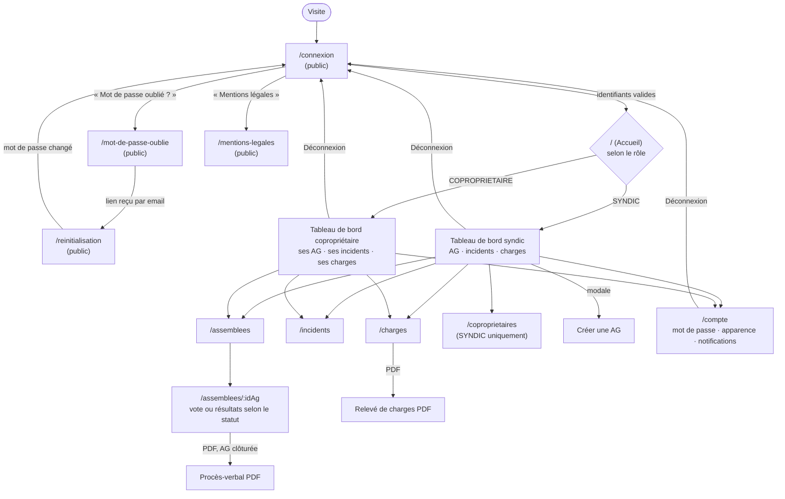

# Schéma d'enchaînement des écrans

Dérivé du routeur réel (`apps/frontend/src/App.tsx`, `RouteProtegee.tsx`, `Shell.tsx`) — pas d'une maquette, pour rester fidèle à ce qui est réellement navigable.

## Règles de navigation réelles

- **Garde de route par authentification** (`RouteProtegee.tsx`) : toute route hors `/connexion`, `/mot-de-passe-oublie`, `/reinitialisation`, `/mentions-legales` redirige vers `/connexion` sans session valide, avec l'URL d'origine conservée (`location.state.from`) pour y revenir après connexion.
- **Garde de route par rôle** : `/coproprietaires` redirige vers `/` pour un compte `COPROPRIETAIRE` (prop `roles={['SYNDIC']}` sur `RouteProtegee`) — vérification uniquement côté présentation, jamais la seule protection réelle (le serveur revérifie systématiquement, cf. `docs/08-security`).
- **Page d'accueil différenciée par rôle**, pas une redirection : `Accueil()` (`App.tsx`) rend `DashboardSyndic` ou `DashboardCoproprietaire` directement sur `/`, sans changer d'URL.
- **Toute route inconnue** (`*`) redirige vers `/`.
- **Navigation principale** (`Shell.tsx`, `NAV_ITEMS`) : chaque lien porte la liste des rôles autorisés à le voir ; « Tableau de bord » et les trois écrans métier (Assemblées, Incidents, Charges) sont visibles pour les deux rôles, « Copropriétaires » uniquement pour le syndic.
