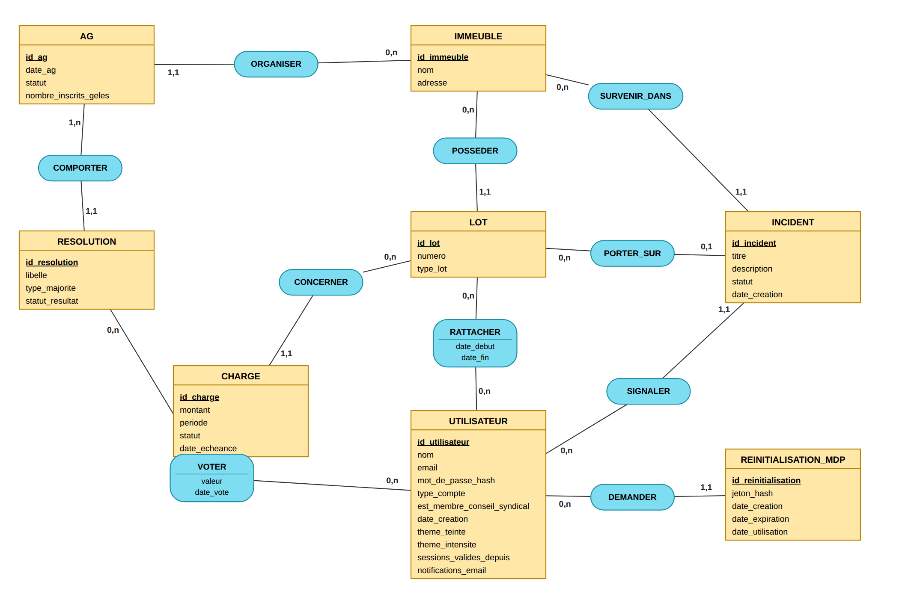
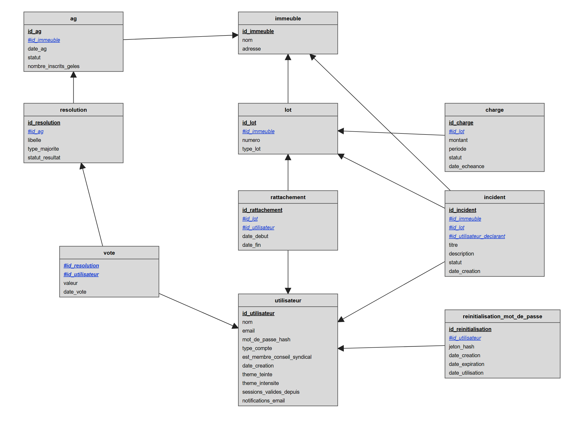
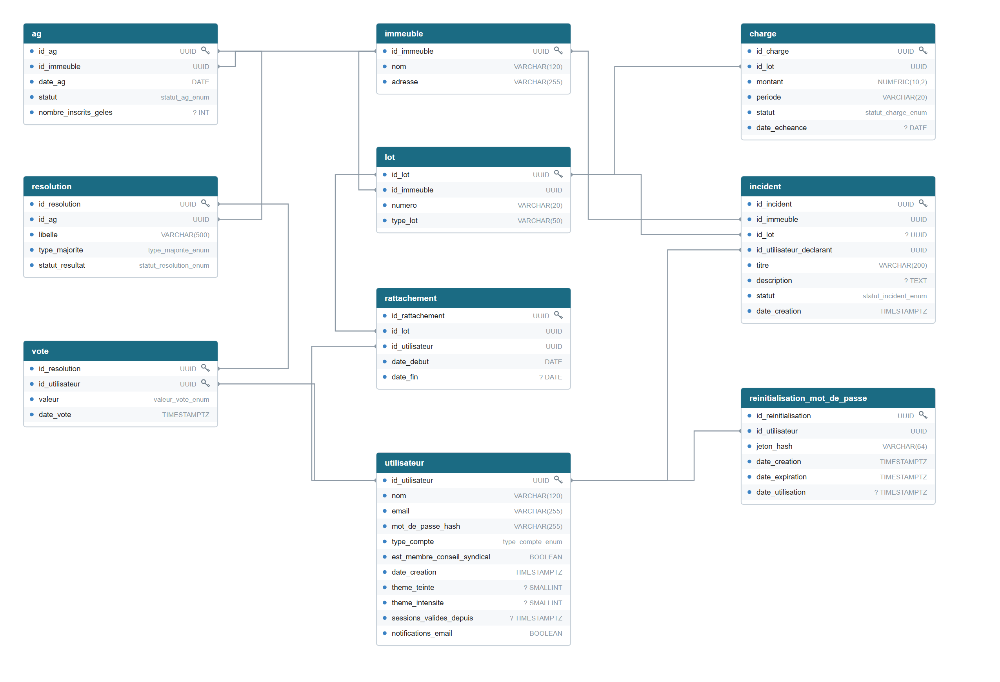

# Modélisation Merise

Démarche suivie, dans l'ordre : **dictionnaire de données → MCD → MLD → MPD**.

1. [Dictionnaire de données](dictionnaire-donnees.md) : toutes les données élémentaires, en termes non techniques (format, longueur, contraintes).
2. **MCD** (modèle conceptuel) : les entités, les associations et leurs cardinalités, sans aucune notion technique.
3. **MLD** (modèle logique) : le MCD traduit en tables relationnelles avec clés primaires et clés étrangères.
4. [MPD](mpd.md) (modèle physique) : les tables telles qu'elles existent en PostgreSQL, avec leurs types réels, contraintes et index.

Les schémas sont fournis en image (PNG) et en vectoriel (SVG) dans [`schemas/`](schemas/), dans la notation habituelle de Merise (entités et associations pour le MCD, tables reliées par des flèches pour le MLD).

## MCD — modèle conceptuel des données

Entités en jaune (l'identifiant est en gras et souligné), associations en bleu (un verbe à l'infinitif), cardinalités écrites **du côté de l'entité** : `(0,n)` signifie que l'entité participe à l'association de zéro à plusieurs fois.

### Entités

| Entité | Identifiant | Attributs |
|---|---|---|
| IMMEUBLE | id_immeuble | nom, adresse |
| LOT | id_lot | numero, type_lot |
| UTILISATEUR | id_utilisateur | nom, email, mot_de_passe_hash, type_compte, est_membre_conseil_syndical, date_creation, theme_teinte, theme_intensite, sessions_valides_depuis, notifications_email |
| AG | id_ag | date_ag, statut, nombre_inscrits_geles |
| RESOLUTION | id_resolution | libelle, type_majorite, statut_resultat |
| CHARGE | id_charge | montant, periode, statut, date_echeance |
| INCIDENT | id_incident | titre, description, statut, date_creation |
| REINITIALISATION_MDP | id_reinitialisation | jeton_hash, date_creation, date_expiration, date_utilisation |

`type_compte` prend les valeurs SYNDIC ou COPROPRIETAIRE. `est_membre_conseil_syndical` n'a de sens que pour un COPROPRIETAIRE (contrainte CHECK en base).

### Associations et cardinalités

| Association | Entité (min,max) | Entité (min,max) | Attributs portés | Lecture |
|---|---|---|---|---|
| POSSEDER | IMMEUBLE (0,n) | LOT (1,1) | — | un immeuble possède plusieurs lots ; un lot appartient à un seul immeuble |
| ORGANISER | IMMEUBLE (0,n) | AG (1,1) | — | un immeuble organise plusieurs assemblées dans le temps |
| COMPORTER | AG (1,n) | RESOLUTION (1,1) | — | une assemblée comporte au moins une résolution (ordre du jour non vide) |
| RATTACHER | LOT (0,n) | UTILISATEUR (0,n) | date_debut, date_fin | un lot a eu plusieurs propriétaires au fil du temps ; un copropriétaire peut avoir plusieurs lots |
| VOTER | RESOLUTION (0,n) | UTILISATEUR (0,n) | valeur, date_vote | un copropriétaire vote sur plusieurs résolutions, une résolution reçoit plusieurs votes (un seul vote par couple) |
| CONCERNER | LOT (0,n) | CHARGE (1,1) | — | une charge concerne un seul lot |
| SURVENIR_DANS | IMMEUBLE (0,n) | INCIDENT (1,1) | — | un incident survient dans un seul immeuble |
| PORTER_SUR | LOT (0,n) | INCIDENT (0,1) | — | un incident concerne au plus un lot ; aucun lot signifie une partie commune |
| SIGNALER | UTILISATEUR (0,n) | INCIDENT (1,1) | — | un incident a un seul déclarant |
| DEMANDER | UTILISATEUR (0,n) | REINITIALISATION_MDP (1,1) | — | une demande de réinitialisation émane d'un seul utilisateur |

## MLD — modèle logique des données

Les clés primaires sont soulignées, les clés étrangères précédées de `#`.

Règles de passage du MCD au MLD :

- une entité devient une table, son identifiant devient la clé primaire ;
- une association de cardinalités `(x,n)` / `(1,1)` disparaît : l'identifiant du côté `n` migre dans la table du côté `(1,1)` comme clé étrangère (par exemple `id_immeuble` dans `lot`) ;
- une association `(0,n)` / `(0,n)` devient une table : `RATTACHER` donne `rattachement`, `VOTER` donne `vote`, qui reçoivent les attributs portés par l'association ;
- `PORTER_SUR` étant `(0,1)` côté incident, la clé étrangère `id_lot` de `incident` peut être vide (partie commune).

Schéma relationnel :

- immeuble (<u>id_immeuble</u>, nom, adresse)
- lot (<u>id_lot</u>, numero, type_lot, #id_immeuble)
- utilisateur (<u>id_utilisateur</u>, nom, email, mot_de_passe_hash, type_compte, est_membre_conseil_syndical, date_creation, theme_teinte, theme_intensite, sessions_valides_depuis, notifications_email)
- rattachement (<u>id_rattachement</u>, date_debut, date_fin, #id_lot, #id_utilisateur)
- ag (<u>id_ag</u>, date_ag, statut, nombre_inscrits_geles, #id_immeuble)
- resolution (<u>id_resolution</u>, libelle, type_majorite, statut_resultat, #id_ag)
- vote (<u>#id_resolution</u>, <u>#id_utilisateur</u>, valeur, date_vote)
- charge (<u>id_charge</u>, montant, periode, statut, date_echeance, #id_lot)
- incident (<u>id_incident</u>, titre, description, statut, date_creation, #id_immeuble, #id_lot, #id_utilisateur_declarant)
- reinitialisation_mot_de_passe (<u>id_reinitialisation</u>, jeton_hash, date_creation, date_expiration, date_utilisation, #id_utilisateur)

## MPD — modèle physique des données

Le détail table par table (types PostgreSQL, contraintes, index) est dans [mpd.md](mpd.md). Le schéma réellement migré se trouve dans `apps/backend/prisma/schema.prisma` et `apps/backend/prisma/migrations/`.

## Choix de conception

- `RATTACHER` devient la table `rattachement` avec un identifiant propre et un index unique **partiel** (`WHERE date_fin IS NULL`) : c'est le moyen d'exprimer « un seul rattachement actif par lot » tout en gardant l'historique complet.
- `VOTER` devient la table `vote`, de clé primaire composite `(id_resolution, id_utilisateur)` : un second vote est impossible par construction, pas seulement par le code applicatif.
- `incident.id_lot` est facultatif : l'absence de valeur signifie « partie commune », jamais une valeur factice.
- Les identifiants sont générés par la base (`gen_random_uuid()`), pas par l'ORM.

Voir aussi [09-database](../09-database/README.md) et [13-decisions](../13-decisions/).
