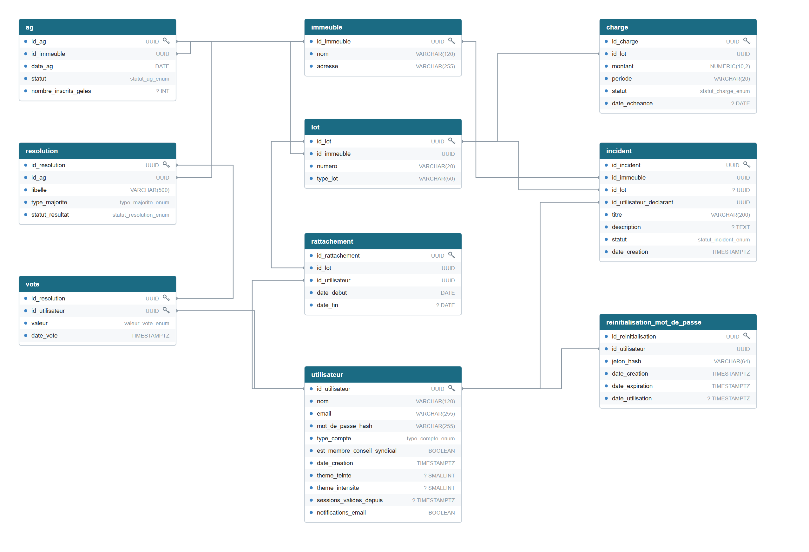

# Modèle physique de données (MPD)

Transcrit depuis les fichiers réellement appliqués en base — `apps/backend/prisma/schema.prisma` et les 7 migrations (`apps/backend/prisma/migrations/0001_init` à `0007_notifications_email`) — vérifié sans dérive par `npm run prisma:drift` (branché en CI). Types PostgreSQL réels, pas les types Prisma déclaratifs.

Schéma vectoriel : [`schemas/mpd.svg`](schemas/mpd.svg). Le détail de chaque table suit.

## `immeuble`

| Colonne | Type | Contraintes |
|---|---|---|
| id_immeuble | UUID | PK, `DEFAULT gen_random_uuid()` |
| nom | VARCHAR(120) | NOT NULL |
| adresse | VARCHAR(255) | NOT NULL |

## `utilisateur`

| Colonne | Type | Contraintes |
|---|---|---|
| id_utilisateur | UUID | PK, `DEFAULT gen_random_uuid()` |
| nom | VARCHAR(120) | NOT NULL |
| email | VARCHAR(255) | NOT NULL, UNIQUE |
| mot_de_passe_hash | VARCHAR(255) | NOT NULL |
| type_compte | type_compte_enum | NOT NULL, ∈ {SYNDIC, COPROPRIETAIRE} |
| est_membre_conseil_syndical | BOOLEAN | NOT NULL, DEFAULT FALSE |
| date_creation | TIMESTAMPTZ | NOT NULL, DEFAULT now() |
| theme_teinte | SMALLINT | NULL — migration 0005 |
| theme_intensite | SMALLINT | NULL — migration 0005 |
| sessions_valides_depuis | TIMESTAMPTZ | NULL — migration 0006 |
| notifications_email | BOOLEAN | NOT NULL, DEFAULT TRUE — migration 0007 |
| **CHECK** `chk_conseil_syndical_coproprietaire` | | `est_membre_conseil_syndical = FALSE OR type_compte = 'COPROPRIETAIRE'` |
| **CHECK** (migration 0005) | | bornes de `theme_teinte` (0–359) et `theme_intensite` (0–100), et « les deux renseignés ou aucun » |

## `lot`

| Colonne | Type | Contraintes |
|---|---|---|
| id_lot | UUID | PK, `DEFAULT gen_random_uuid()` |
| id_immeuble | UUID | NOT NULL, FK → immeuble(id_immeuble) ON DELETE CASCADE |
| numero | VARCHAR(20) | NOT NULL |
| type_lot | VARCHAR(50) | NOT NULL |
| **UNIQUE** | | (id_immeuble, numero) |
| **INDEX** idx_lot_immeuble | | (id_immeuble) |

## `rattachement`

| Colonne | Type | Contraintes |
|---|---|---|
| id_rattachement | UUID | PK, `DEFAULT gen_random_uuid()` |
| id_lot | UUID | NOT NULL, FK → lot(id_lot) ON DELETE CASCADE |
| id_utilisateur | UUID | NOT NULL, FK → utilisateur(id_utilisateur) ON DELETE RESTRICT |
| date_debut | DATE | NOT NULL, DEFAULT CURRENT_DATE |
| date_fin | DATE | NULL |
| **CHECK** `chk_periode` | | `date_fin IS NULL OR date_fin > date_debut` |
| **INDEX UNIQUE PARTIEL** idx_rattachement_actif_unique | | (id_lot) WHERE date_fin IS NULL — un seul rattachement actif par lot |

## `ag`

| Colonne | Type | Contraintes |
|---|---|---|
| id_ag | UUID | PK, `DEFAULT gen_random_uuid()` |
| id_immeuble | UUID | NOT NULL, FK → immeuble(id_immeuble) ON DELETE CASCADE |
| date_ag | DATE | NOT NULL |
| statut | statut_ag_enum | NOT NULL, DEFAULT 'PLANIFIEE', ∈ {PLANIFIEE, OUVERTE, CLOTUREE} |
| nombre_inscrits_geles | INT | NULL — migration 0002, figé à l'ouverture du vote |

## `resolution`

| Colonne | Type | Contraintes |
|---|---|---|
| id_resolution | UUID | PK, `DEFAULT gen_random_uuid()` |
| id_ag | UUID | NOT NULL, FK → ag(id_ag) ON DELETE CASCADE |
| libelle | VARCHAR(500) | NOT NULL |
| type_majorite | type_majorite_enum | NOT NULL, ∈ {SIMPLE, ABSOLUE, DOUBLE_MAJORITE, UNANIMITE} |
| statut_resultat | statut_resolution_enum | NOT NULL, DEFAULT 'EN_ATTENTE', ∈ {EN_ATTENTE, ADOPTEE, REJETEE} |
| **INDEX** idx_resolution_ag | | (id_ag) |

## `vote`

| Colonne | Type | Contraintes |
|---|---|---|
| id_resolution | UUID | FK → resolution(id_resolution) ON DELETE CASCADE |
| id_utilisateur | UUID | FK → utilisateur(id_utilisateur) ON DELETE RESTRICT |
| valeur | valeur_vote_enum | NOT NULL, ∈ {OUI, NON, ABSTENTION} |
| date_vote | TIMESTAMPTZ | NOT NULL, DEFAULT now() |
| **PK COMPOSITE** | | (id_resolution, id_utilisateur) — garantit RM-02 au niveau base |

## `charge`

| Colonne | Type | Contraintes |
|---|---|---|
| id_charge | UUID | PK, `DEFAULT gen_random_uuid()` |
| id_lot | UUID | NOT NULL, FK → lot(id_lot) ON DELETE CASCADE |
| montant | NUMERIC(10,2) | NOT NULL, **CHECK** `montant > 0` |
| periode | VARCHAR(20) | NOT NULL |
| statut | statut_charge_enum | NOT NULL, DEFAULT 'A_PAYER', ∈ {A_PAYER, PAYEE, EN_RETARD} |
| date_echeance | DATE | NULL — migration 0003 |
| **INDEX** idx_charge_lot | | (id_lot) |

## `incident`

| Colonne | Type | Contraintes |
|---|---|---|
| id_incident | UUID | PK, `DEFAULT gen_random_uuid()` |
| id_immeuble | UUID | NOT NULL, FK → immeuble(id_immeuble) ON DELETE CASCADE |
| id_lot | UUID | NULL, FK → lot(id_lot) ON DELETE SET NULL — NULL = partie commune |
| id_utilisateur_declarant | UUID | NOT NULL, FK → utilisateur(id_utilisateur) ON DELETE RESTRICT |
| titre | VARCHAR(200) | NOT NULL |
| description | TEXT | NULL |
| statut | statut_incident_enum | NOT NULL, DEFAULT 'DECLARE', ∈ {DECLARE, EN_COURS, RESOLU} |
| date_creation | TIMESTAMPTZ | NOT NULL, DEFAULT now() |
| **INDEX** idx_incident_immeuble_statut | | (id_immeuble, statut) |

## `reinitialisation_mot_de_passe`

Migration 0004 — jamais le jeton en clair, seulement son empreinte.

| Colonne | Type | Contraintes |
|---|---|---|
| id_reinitialisation | UUID | PK, `DEFAULT gen_random_uuid()` |
| id_utilisateur | UUID | NOT NULL, FK → utilisateur(id_utilisateur) ON DELETE CASCADE |
| jeton_hash | VARCHAR(64) | NOT NULL, UNIQUE — empreinte SHA-256 du jeton |
| date_creation | TIMESTAMPTZ | NOT NULL, DEFAULT now() |
| date_expiration | TIMESTAMPTZ | NOT NULL |
| date_utilisation | TIMESTAMPTZ | NULL — usage unique, NULL tant que non consommé |
| **INDEX** idx_reinitialisation_utilisateur | | (id_utilisateur) |

## Extension et types énumérés

- `CREATE EXTENSION IF NOT EXISTS "pgcrypto"` — nécessaire à `gen_random_uuid()`.
- 7 types ENUM PostgreSQL natifs (`type_compte_enum`, `type_majorite_enum`, `statut_resolution_enum`, `valeur_vote_enum`, `statut_ag_enum`, `statut_charge_enum`, `statut_incident_enum`) — les valeurs invalides sont rejetées par le SGBD lui-même, avant même la validation Zod côté application (défense en profondeur).
