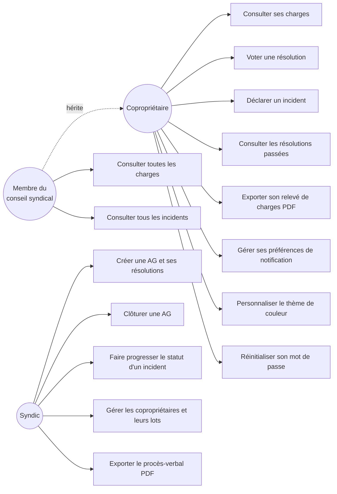
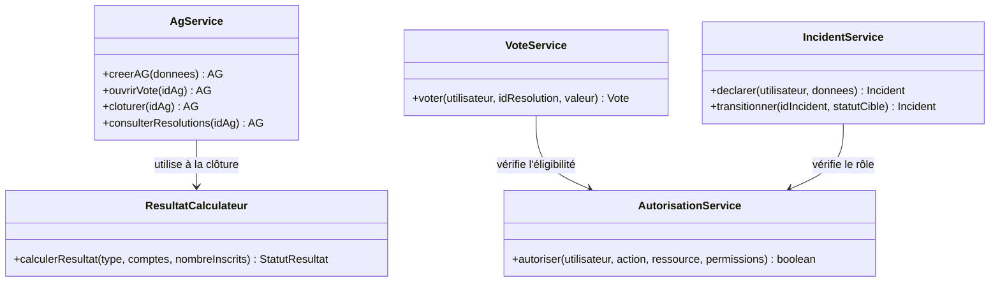
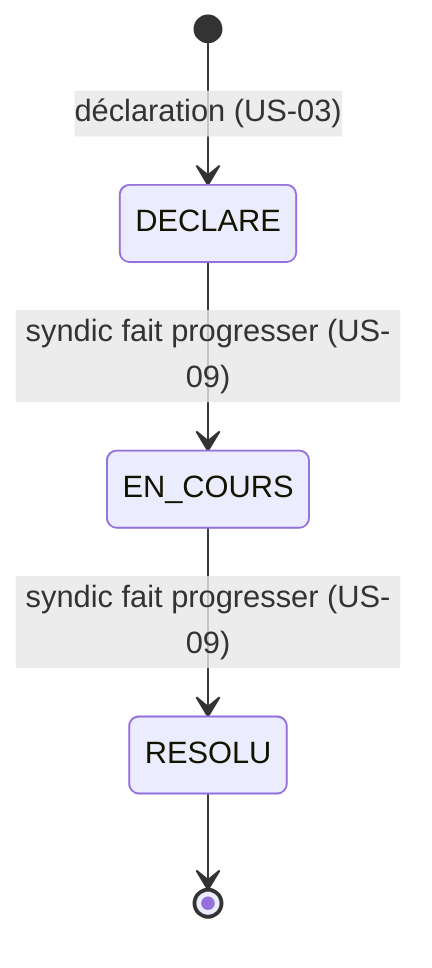
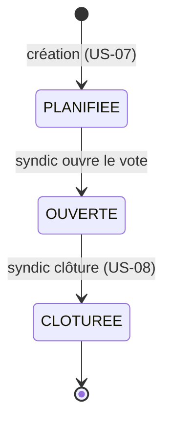
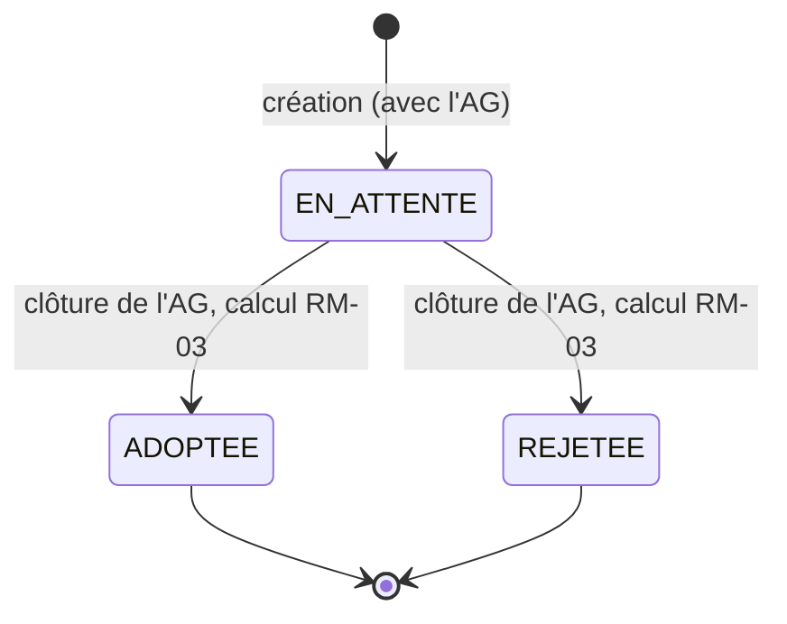

# Modélisation UML

Export condensé du Doc 3 § UML.

## Cas d'utilisation

| Acteur | Cas d'utilisation | User story |
|---|---|---|
| Copropriétaire | Consulter ses charges | US-01 |
| Copropriétaire | Voter une résolution | US-02 |
| Copropriétaire | Déclarer un incident | US-03 |
| Copropriétaire | Consulter les résolutions passées | US-04 |
| Conseil syndical | Consulter toutes les charges de l'immeuble | US-05 |
| Conseil syndical | Consulter tous les incidents | US-06 |
| Syndic | Créer une AG et ses résolutions | US-07 |
| Syndic | Clôturer une AG | US-08 |
| Syndic | Faire progresser le statut d'un incident | US-09 |
| Syndic | Gérer les copropriétaires et leurs lots | US-10 |

Complétés depuis le backlog MVP par les fonctionnalités V1 (F-12 à F-15, livrées après le Doc 2 initial — non rattachées à une US du MVP) : export PDF, notifications par email, réinitialisation de mot de passe, personnalisation du thème.



Le conseil syndical est un compte copropriétaire avec un drapeau supplémentaire (`est_membre_conseil_syndical`) : il hérite de tous les cas d'usage du copropriétaire et en cumule d'autres (RM-14) — jamais un remplacement.

## Diagramme de classes (Business Layer)

Les classes du Business Layer (`apps/backend/src/services/`) portent les règles métier, pas les entités du MPD elles-mêmes (celles-ci sont gérées par Prisma). La classe clé pour la certification est `ResultatCalculateur` — logique pure, sans dépendance à Express ni Prisma, entièrement testable en isolation (voir `resultat-calculateur.test.ts`, 29 cas aux frontières).



`ResultatCalculateur` n'a pas d'état — une fonction pure `(type, comptes, nombreInscrits) → statut`, ce qui permet de la tester en 29 cas aux frontières sans aucun mock.

## Diagrammes de séquence

Dérivés directement du code réel (`apps/backend/src/controllers/vote.controller.ts`, `services/vote.service.ts`, `repositories/vote.repository.ts`, `services/ag.service.ts`, `repositories/ag.repository.ts`) plutôt que d'une maquette de conception — leur comportement est vérifié par `ag-vote-cloture.integration.test.ts` et `vote-cloture-concurrence.integration.test.ts`.

### Voter une résolution, avec vérification d'éligibilité

```mermaid
sequenceDiagram
  actor C as Copropriétaire
  participant Ctrl as voteController
  participant Svc as voteService
  participant LotRepo as lotRepository
  participant VoteRepo as voteRepository
  participant DB as PostgreSQL

  C->>Ctrl: POST /resolutions/:id/votes {valeur}
  Ctrl->>Ctrl: validation Zod (valeur ∈ {OUI,NON,ABSTENTION})
  Ctrl->>Svc: voter(utilisateur, idResolution, valeur)
  alt utilisateur.typeCompte ≠ COPROPRIETAIRE
    Svc-->>Ctrl: VoteInterditError
    Ctrl-->>C: 403
  end
  Svc->>LotRepo: lotsRattachesAUtilisateur(utilisateur.id)
  LotRepo->>DB: SELECT lots rattachés actifs
  DB-->>LotRepo: []
  alt aucun lot rattaché
    Svc-->>Ctrl: VoteInterditError
    Ctrl-->>C: 403
  end
  Svc->>VoteRepo: enregistrerSiAgOuverte(idResolution, utilisateur.id, valeur)
  VoteRepo->>DB: BEGIN ; SELECT statut AG FOR SHARE
  alt AG non trouvée
    DB-->>VoteRepo: aucune ligne
    VoteRepo-->>Svc: RESOLUTION_INTROUVABLE
    Svc-->>Ctrl: ResolutionIntrouvableError
    Ctrl-->>C: 404
  else AG non OUVERTE
    VoteRepo-->>Svc: AG_NON_OUVERTE
    Svc-->>Ctrl: AgNonOuverteError
    Ctrl-->>C: 409
  else AG ouverte
    VoteRepo->>DB: INSERT INTO vote ... ON CONFLICT DO NOTHING
    alt vote déjà existant (clé composite)
      DB-->>VoteRepo: 0 ligne insérée
      VoteRepo->>DB: COMMIT
      VoteRepo-->>Svc: DEJA_VOTE
      Svc-->>Ctrl: VoteDejaExprimeError
      Ctrl-->>C: 409
    else nouveau vote
      DB-->>VoteRepo: 1 ligne insérée
      VoteRepo->>DB: COMMIT
      VoteRepo-->>Svc: ENREGISTRE, vote
      Svc-->>Ctrl: vote
      Ctrl-->>C: 201 {vote}
    end
  end
```

Le verrou `FOR SHARE OF a` posé sur la ligne AG, dans la même transaction que l'`INSERT`, est ce qui rend ce parcours atomique vis-à-vis d'une clôture concurrente (séquence suivante) : soit le vote passe avant la clôture, soit il la voit déjà `CLOTUREE` et est refusé — jamais un état intermédiaire incohérent.

### Clôturer une AG, avec calcul atomique des résultats

```mermaid
sequenceDiagram
  actor S as Syndic
  participant Ctrl as agController
  participant Svc as agService
  participant Repo as agRepository
  participant Calc as resultatCalculateur
  participant DB as PostgreSQL

  S->>Ctrl: POST /ags/:idAg/cloture
  Ctrl->>Ctrl: exigerRoleSyndic (RM-14)
  Ctrl->>Svc: cloturer(idAg)
  Svc->>Repo: parId(idAg)
  Repo->>DB: SELECT ag
  alt AG introuvable
    DB-->>Repo: null
    Repo-->>Svc: null
    Svc-->>Ctrl: AgIntrouvableError
    Ctrl-->>S: 404
  else statut ≠ OUVERTE
    Svc-->>Ctrl: ClotureAgImpossibleError
    Ctrl-->>S: 409
  else statut = OUVERTE
    Svc->>Repo: cloturerAvecResultats(idAg, calculerResultat)
    Repo->>DB: BEGIN ; UPDATE ag SET statut='CLOTUREE' WHERE statut='OUVERTE'
    alt 0 ligne modifiée (clôture concurrente déjà passée)
      DB-->>Repo: count = 0
      Repo->>DB: ROLLBACK
      Repo-->>Svc: null
      Svc-->>Ctrl: ClotureAgImpossibleError
      Ctrl-->>S: 409
    else clôture posée
      Repo->>DB: SELECT nombre_inscrits_geles (figé à l'ouverture, RM-03)
      Repo->>DB: SELECT résolutions + GROUP BY décomptes (oui/non/abstention)
      loop pour chaque résolution
        Repo->>Calc: calculerResultat(typeMajorite, comptes, nombreInscrits)
        Calc-->>Repo: ADOPTEE | REJETEE
        Repo->>DB: UPDATE resolution SET statut_resultat = ...
      end
      Repo->>DB: COMMIT
      Repo-->>Svc: ag + résolutions figées
      Svc-->>Ctrl: ag
      Ctrl-->>S: 200 {ag}
    end
  end
```

Le `UPDATE ... WHERE statut='OUVERTE'` conditionnel (pas un `SELECT` puis `UPDATE` séparés) est ce qui empêche une double clôture concurrente de réussir deux fois — la seconde requête trouve `count = 0` et échoue proprement, sans jamais recalculer un résultat déjà figé.

## Diagrammes d'états-transitions

### Incident (RM-11 à RM-13)



Aucun saut d'étape (DECLARE → RESOLU direct refusé), aucun retour en arrière (RESOLU → EN_COURS refusé) — RM-13, testé explicitement (`incident-transition.integration.test.ts`).

### AG (RM-05)



### Résolution (statut du résultat)



Ces trois machines à états partagent le même principe d'implémentation réel : une transition conditionnelle en base (`UPDATE ... WHERE statut = '<attendu>'`), jamais un « lire puis écrire » qui laisserait une fenêtre de course — vérifié par les tests de concurrence (`vote-cloture-concurrence.integration.test.ts`).
