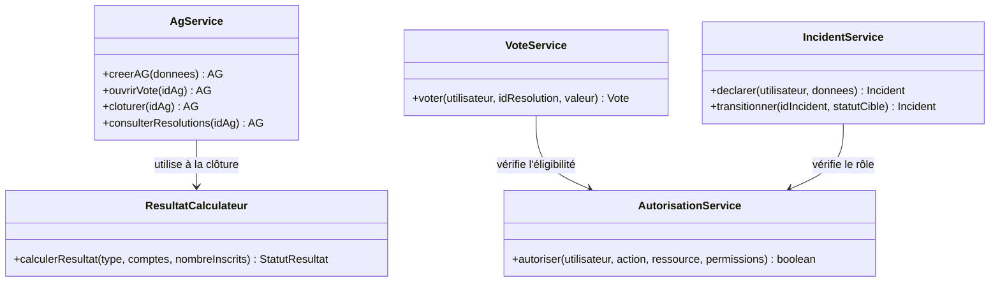
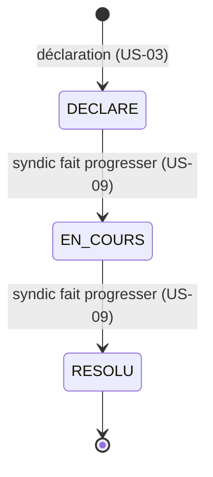
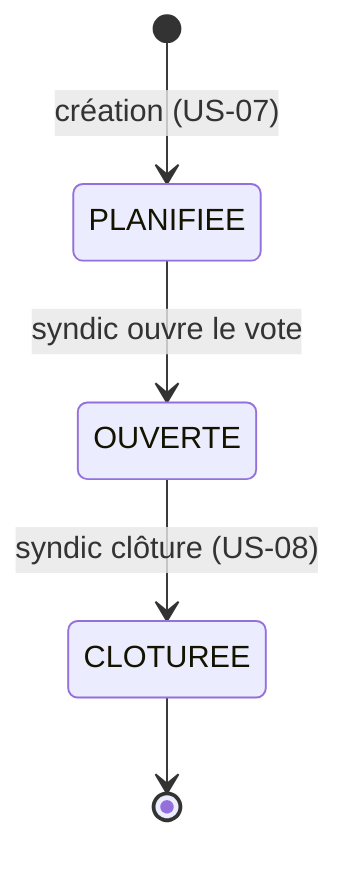
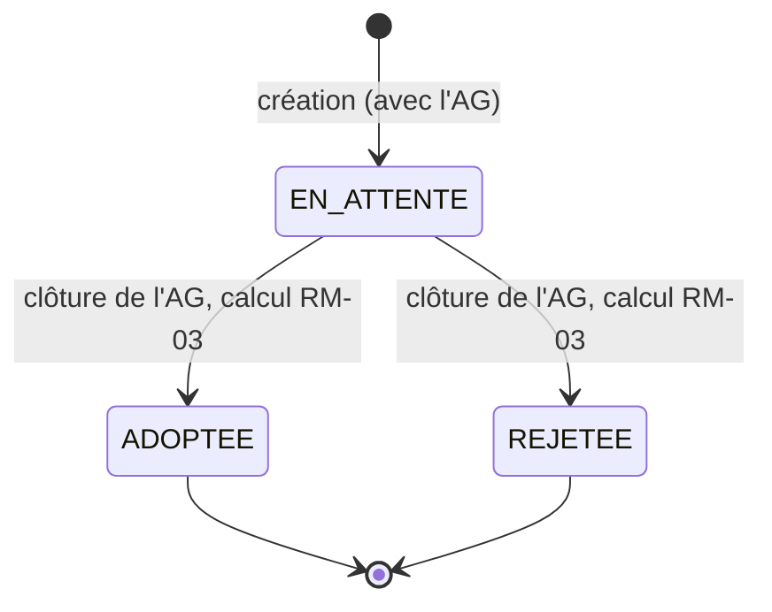

# Modélisation UML

Export condensé du Doc 3 § UML.

## Cas d'utilisation

| Acteur | Cas d'utilisation | User story |
|---|---|---|
| Copropriétaire | Consulter ses charges | US-01 |
| Copropriétaire | Voter une résolution | US-02 |
| Copropriétaire | Déclarer un incident | US-03 |
| Copropriétaire | Consulter les résolutions passées | US-04 |
| Conseil syndical | Consulter toutes les charges de l'immeuble | US-05 |
| Conseil syndical | Consulter tous les incidents | US-06 |
| Syndic | Créer une AG et ses résolutions | US-07 |
| Syndic | Clôturer une AG | US-08 |
| Syndic | Faire progresser le statut d'un incident | US-09 |
| Syndic | Gérer les copropriétaires et leurs lots | US-10 |

## Diagramme de classes (Business Layer)

Les classes du Business Layer (`apps/backend/src/services/`) portent les règles métier, pas les entités du MPD elles-mêmes (celles-ci sont gérées par Prisma). La classe clé pour la certification est `ResultatCalculateur` — logique pure, sans dépendance à Express ni Prisma, entièrement testable en isolation (voir `resultat-calculateur.test.ts`, 29 cas aux frontières).

`ResultatCalculateur` n'a pas d'état — une fonction pure `(type, comptes, nombreInscrits) → statut`, ce qui permet de la tester en 29 cas aux frontières sans aucun mock.

## Diagrammes de séquence

Trois séquences clés vivent dans le document source (rendues en mermaid) : création d'AG par le syndic, vote d'un copropriétaire avec vérification d'éligibilité, clôture avec calcul atomique des résultats. Leur comportement réel est couvert par les tests d'intégration correspondants (`ag-vote-cloture.integration.test.ts`, `vote-cloture-concurrence.integration.test.ts`).

## Diagrammes d'états-transitions

### Incident (RM-11 à RM-13)

Aucun saut d'étape (DECLARE → RESOLU direct refusé), aucun retour en arrière (RESOLU → EN_COURS refusé) — RM-13, testé explicitement (`incident-transition.integration.test.ts`).

### AG (RM-05)

### Résolution (statut du résultat)

Ces trois machines à états partagent le même principe d'implémentation réel : une transition conditionnelle en base (`UPDATE ... WHERE statut = '<attendu>'`), jamais un « lire puis écrire » qui laisserait une fenêtre de course — vérifié par les tests de concurrence (`vote-cloture-concurrence.integration.test.ts`).
