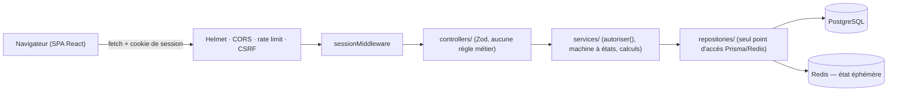

# Architecture

Voir [ADR-001](../13-decisions/ADR-001-architecture-3-couches.md) pour la décision et sa justification complète. Résumé opérationnel ci-dessous.

## Vue d'ensemble

```
apps/
  frontend/   Presentation Layer — React 18 + Vite + TypeScript (SPA)
  backend/
    src/
      controllers/    point d'entrée HTTP (Express), aucune règle métier
      services/       Business Layer — logique métier, autorisation
      repositories/   Data Access Layer — seul point d'accès à Prisma ET à Redis (état technique éphémère uniquement)
      middleware/     session (cookie signé), CSRF (vérification d'origine), gestion des erreurs async
      types/          types partagés entre couches
    prisma/           schéma + migrations (reflète le MPD, Doc 3)
```

## Flux d'une requête type

1. Le frontend appelle `fetch` avec `credentials: 'include'` (`apps/frontend/src/api/client.ts`) — jamais d'accès direct à la base.
2. `app.ts` applique les middlewares transverses (Helmet, CORS, rate limit global, puis `sessionMiddleware` qui peuple `req.utilisateur` si un cookie de session valide est présent).
3. Le contrôleur valide le corps de la requête avec Zod (liste blanche stricte des champs acceptés — anti mass assignment, Doc 5), puis appelle le service.
4. Le service applique les règles métier (autorisation via `autoriser()`, machine à états, calcul de résultat…) et appelle le repository.
5. Le repository est le seul point de contact avec Prisma ; les transactions atomiques (création d'AG + résolutions, clôture + calcul de résultats) vivent ici.
6. Les erreurs métier remontent sous forme de classes d'erreur typées (`AgIntrouvableError`, `VoteDejaExprimeError`…), traduites en codes HTTP par le contrôleur — jamais de détail technique renvoyé au client (NF-06).

## Authentification et session

Cookie de session signé HttpOnly/SameSite=Strict (Secure en production), sans table de session en base (le cookie porte l'identifiant utilisateur + un timestamp, signé avec `SESSION_SECRET`, durée de vie 8h). La révocation à la déconnexion (`session_revoquee:<signature>`, TTL) et le rate limiting sont partagés entre plusieurs instances du backend via Redis quand `REDIS_URL` est défini (`repositories/redis-client.ts`), avec repli automatique en mémoire du processus sinon — seul usage NoSQL du projet, strictement limité à de l'état technique éphémère (jamais une donnée métier). Défense CSRF complémentaire : `middleware/csrf.middleware.ts` vérifie l'en-tête `Origin`/`Referer` sur toute requête qui modifie un état.

## Réseau des couches et sécurité



## Frontend

SPA React sans framework CSS : le design system (Doc 4) est appliqué via des styles inline et des variables CSS (`apps/frontend/src/index.css`), portés depuis une maquette Figma (`proto/`, conservée pour référence, non exécutée en CI). Routage basé sur le rôle du compte connecté (`RouteProtegee.tsx`, `Shell.tsx`). Voir [12-api/](../12-api/README.md) pour le contrat consommé.

### Exports PDF (F-13)

`services/document.service.ts` (bibliothèque `pdfkit`, sans navigateur embarqué) : `pdfProcesVerbal` et `pdfReleveCharges` sont des fonctions pures de mise en page (A4, pied de page « Page n / N », pagination avec titres de colonnes répétés, PDF non compressé donc inspectable par les tests) ; `documentService.procesVerbalAg` et `releveCharges` assemblent les données en réutilisant `agService.consulterResolutions` et `chargeService.lister`. Routes : `GET /ags/:idAg/proces-verbal.pdf`, `GET /charges/export.pdf`. Côté interface, `BoutonTelechargement` et `api.telecharger` (fetch + cookie, nom de fichier choisi par le client).

### Événements et notifications (F-12)

`services/evenements.service.ts` est un petit bus interne : les services métier (`ag.service`, `incident.service`, `charge.service`) annoncent `AG_OUVERTE`, `AG_CLOTUREE`, `INCIDENT_STATUT_MODIFIE`, `CHARGE_CREEE` **après** le succès de l'écriture, sans savoir qui s'y intéresse. `services/notification.service.ts` s'y abonne au démarrage (`server.ts`, jamais dans `createApp()` : les tests restent silencieux tant qu'ils ne s'abonnent pas) et envoie les courriels via `mail.service.ts` (SMTP configurable, silencieux si `SMTP_HOST` est absent). Un abonné en erreur n'affecte ni l'émetteur ni les autres abonnés.

### Thème de couleur

`apps/frontend/src/theme/` : `oklch.ts` (conversions et gamut), `contraste.ts` (ratios WCAG), `genererTheme.ts` (palette à partir de `{teinte, intensite}`, pure et déterministe), `appliquerTheme.ts` (variables CSS via le CSSOM), `themeStorage.ts` (cache `localStorage` anti-flash), `noms-teintes.ts`. `context/ThemeContext.tsx` (sous `AuthProvider`) applique le thème du compte sur `<html>` ; les composants lisent `var(--…)`, donc un changement de thème ne re-rend rien. Flux : `main.tsx` applique le cache avant le premier rendu → `/auth/moi` renvoie `utilisateur.theme` (le serveur a le dernier mot) → `PUT/DELETE /utilisateurs/moi/theme` à l'enregistrement → déconnexion : retour à Classique et cache effacé. Côté backend : `theme.service.ts`, deux méthodes dans `utilisateur.repository.ts`, colonnes `theme_teinte`/`theme_intensite` (migration `0005`). Décisions : ADR-003 et ADR-004.

## Déploiement

Docker Compose local (`docker-compose.yml`) : service `migrate` (applique les migrations) → `backend` → `frontend`, plus PostgreSQL. Détails dans [11-devops/](../11-devops/README.md).
